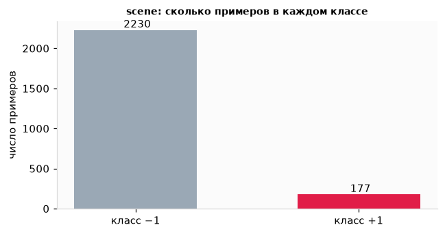
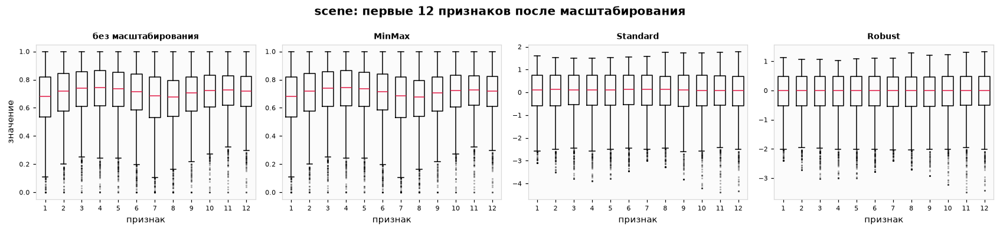
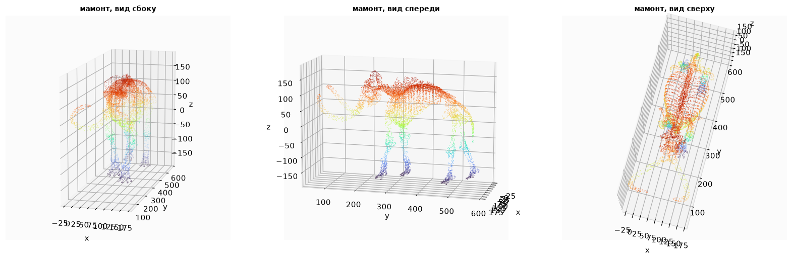
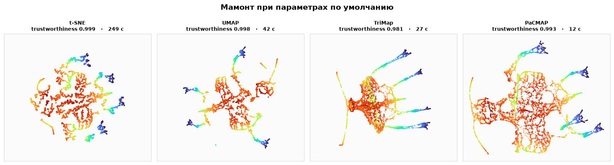
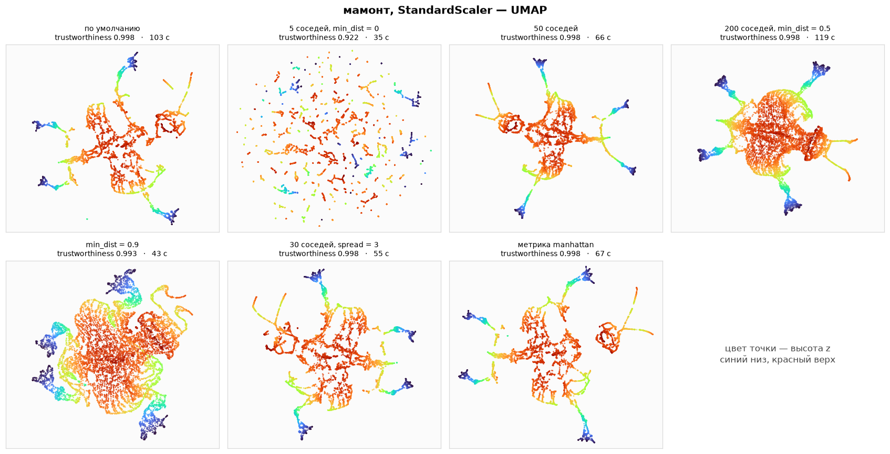
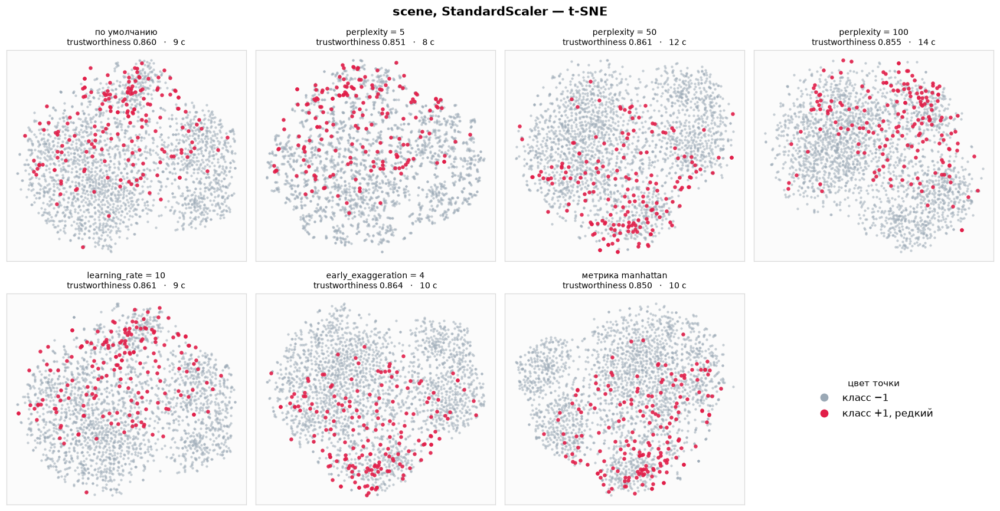
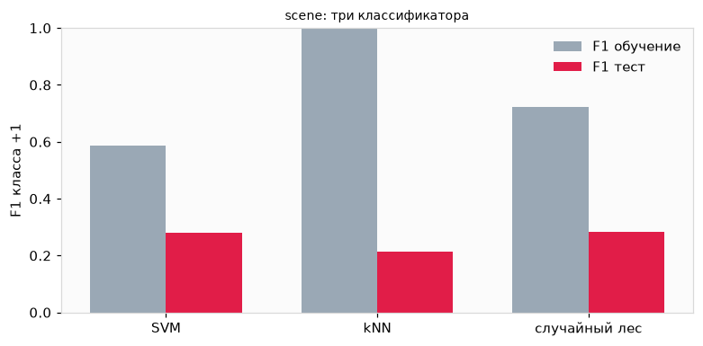
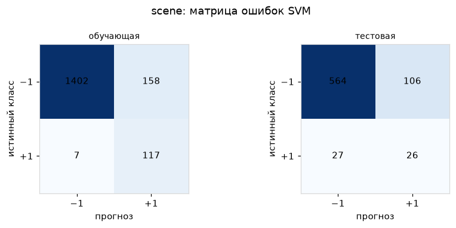
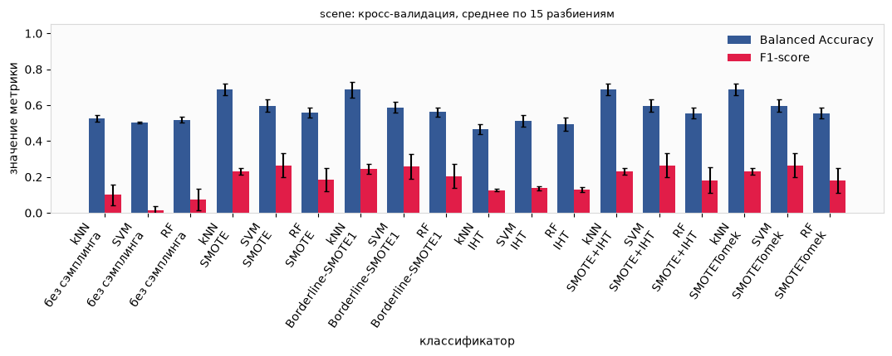

# Практика анализа данных

Три ноутбука про один и тот же перекошенный набор `scene` и про облако точек мамонта. Сначала данные смотрятся в плоскости, затем на `scene` сравниваются классификаторы и способы выровнять редкий класс.

| Ноутбук | О чём |
| --- | --- |
| [TSNE_UMAP_TRIMAP_PACMAP.ipynb](TSNE_UMAP_TRIMAP_PACMAP.ipynb) | t-SNE, UMAP, TriMap и PaCMAP: параметры, масштаб, trustworthiness |
| [clastorization.ipynb](clastorization.ipynb) | SVM, kNN и случайный лес на отложенной выборке |
| [sample.ipynb](sample.ipynb) | SMOTE, Borderline-SMOTE, IHT и SMOTETomek |

Набор `scene` приходит из `imblearn.datasets.fetch_datasets`. Облако мамонта лежит в [`mammoth (1).csv`](mammoth%20(1).csv): почти миллион точек `x`, `y`, `z`, в расчёты взяты 10 000.

## Набор scene

2407 объектов, 294 признака. Класс −1 встречается в 12.6 раза чаще класса +1: 2230 против 177.

  

Редкий класс на такой диаграмме почти теряется. Из-за этого accuracy около 0.93 ещё ничего не говорит: модель может почти всегда отвечать «−1». Дальше качество редкого класса смотрится по F1 и balanced accuracy.

Признаки сильно различаются по размаху, поэтому перед расстояниями их приводят к одному масштабу. MinMax ужимает каждый столбец в отрезок от 0 до 1, Standard выравнивает среднее и разброс, Robust опирается на медиану и межквартильный размах и меньше тянется за выбросами.

  

У первых двенадцати признаков исходный масштаб уже похож на MinMax. Standard и Robust меняют центр и ширину «ящика», и расстояние между объектами перестаёт определяться одним-двумя широкими столбцами.

## Мамонт в плоскости

Файл мамонта — это скелет, у которого форма заранее известна. Цвет точки — высота `z`: синий у ступней, красный у спины и головы. Если алгоритм оторвал ноги от корпуса, это видно сразу, без метрики.

  

Те же 10 000 точек после StandardScaler, параметры методов по умолчанию:

  

t-SNE здесь дольше всех и режет скелет на острова. UMAP, TriMap и PaCMAP оставляют узнаваемый силуэт: ноги уходят в стороны, корпус остаётся целым. PaCMAP при этом укладывается в 12 секунд, t-SNE — в 249.

Число соседей у UMAP решает, держать ли общий контур. При пяти соседях и `min_dist = 0` trustworthiness падает до 0.922 и силуэт рассыпается. При 50 и 200 соседях он снова около 0.998.

  

На `scene` отдельного силуэта нет, поэтому картинка другая: серое облако большинства и красные точки редкого класса. Они не собираются в свой остров ни при какой `perplexity`. Лучший trustworthiness на этой сетке — 0.864 при `early_exaggeration = 4`.

  

Среднее по семи настройкам каждого метода:

| Метод | scene, trustworthiness | scene, время | мамонт, trustworthiness | мамонт, время |
| --- | ---: | ---: | ---: | ---: |
| t-SNE | 0.857 | 10 с | 0.995 | 229 с |
| UMAP | 0.797 | 16 с | 0.987 | 70 с |
| TriMap | 0.820 | 11 с | 0.987 | 82 с |
| PaCMAP | 0.817 | 2 с | 0.994 | 17 с |

На `scene` соседство в исходных 294 признаках сохраняет лучше всего t-SNE. На мамонте все четыре метода выше 0.98, а PaCMAP почти догоняет t-SNE и считает на порядок быстрее. Лучшие отдельные настройки: для `scene` это `early_exaggeration = 4` у t-SNE (0.864), для мамонта — `perplexity = 100` (0.999, около 5 минут).

## Классификаторы

Обучающая и тестовая части — 70/30, стратификация сохраняет тот же перекос 12.6 : 1. Параметры подбирались по F1 редкого класса на кросс-валидации, тест в выборе не участвовал.

| Модель | Лучшие параметры | Accuracy, тест | Recall +1 | F1 +1, тест | F1 +1, обучение |
| --- | --- | ---: | ---: | ---: | ---: |
| SVM, ядро poly | `C=0.1`, `degree=3`, `coef0=1` | 0.816 | 0.491 | 0.281 | 0.587 |
| kNN | 1 сосед, евклидово расстояние | 0.899 | 0.189 | 0.215 | 1.000 |
| Случайный лес | 200 деревьев, глубина 6, лист от 4 | 0.888 | 0.302 | 0.283 | 0.724 |

  

kNN запоминает обучающую выборку: F1 на ней равен 1, на тесте остаётся 0.215. Лес и SVM на тесте почти рядом, около 0.28, но SVM находит редкий класс чаще, а лес реже ошибается на большинстве.

У выбранного SVM на тесте из 53 объектов класса +1 найдены 26. При этом 106 объектов класса −1 помечены как редкие: точность редкого класса всего 0.197.

  

## Сэмплинг

Без выравнивания классов все три модели почти не видят +1. На кросс-валидации из 15 разбиений balanced accuracy держится около 0.50–0.53, а F1 у SVM падает к нулю.

  

SMOTE и Borderline-SMOTE1 достраивают редкий класс до размера большинства. Сильнее всего растёт kNN: balanced accuracy с 0.526 до 0.688. На одном разбиении 70/30 лучший результат у всех трёх моделей даёт Borderline-SMOTE1. У SVM на этом разбиении F1 редкого класса 0.318.

Instance Hardness Threshold срезает выборку слишком сильно, и качество падает ниже обучения без сэмплинга. SMOTE+IHT и SMOTETomek по цифрам совпадают со SMOTE: после выравнивания второму шагу уже нечего удалять.

F1 при этом остаётся в районе 0.2–0.3. Редкий класс находится чаще, но вместе с ним появляется много ложных срабатываний.
